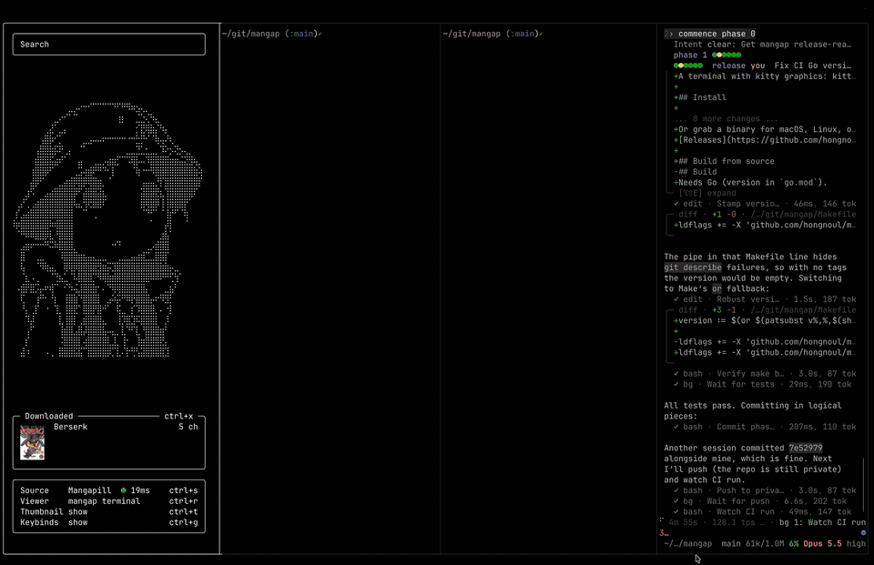

# mangap

<p align="center">
  
</p>

<p align="center">
  <a href="LICENSE"></a>
  <a href="https://github.com/hongnoul/mangap/stargazers"></a>
  <a href="https://github.com/hongnoul/mangap/releases/latest"></a>
</p>

<p align="center"></p>
<p align="center">Running in <a href="https://github.com/hongnoul/gwae">gwae</a> on <a href="https://github.com/ghostty-org/ghostty">Ghostty</a>, MacBook Pro M4</p>

Maintained fork of [mangal](https://github.com/metafates/mangal).

Runs on macOS, Linux, and Windows, in any terminal that supports the kitty graphics protocol.

## Install

> Requires a terminal with kitty graphics: kitty, Ghostty, or WezTerm.

```bash
brew install hongnoul/tap/mangap
```

or with Go:

```bash
go install github.com/hongnoul/mangap@latest
```

Binaries for macOS, Linux, and Windows are on [Releases](https://github.com/hongnoul/mangap/releases).

## Features

| Feature | Default | What it does |
| ------- | ------- | ------------ |
| Infinite&nbsp;scroll | j / k | Pages continue across chapter boundaries in reading order |
| Chapter&nbsp;jump | ctrl+j / ctrl+k | Next or previous chapter |
| Direction | D | Toggles right-to-left and left-to-right. Default `rtl` (`reader.direction`) |
| Live&nbsp;search | type | Results and cover thumbnails update per keystroke from a local catalog |
| Bookmarks | automatic | Saves the exact page on exit and resumes there |
| Source&nbsp;picker | ctrl+s | Lists sources with live RTT. ctrl+o cycles |
| Downloads | ctrl+x | Browse, filter, read, and delete downloaded chapters |
| Download&nbsp;all | ctrl+d | Downloads every chapter of the open manga after confirmation |
| Viewer&nbsp;toggle | ctrl+r | Switches between the in-terminal reader and an external viewer |
| Thumbnails | ctrl+t | Cover thumbnails on or off |
| Anilist&nbsp;sync | `mangap integration anilist` | Marks read chapters on your Anilist list |

List screens use `j`/`k` to move, `l` to open, `h` to go back. `q` leaves the reader. `ctrl+g` shows keybinds.

Downloaded chapters open with `mangap view <folder|file.cbz>`.

## Sources

Built in: Mangapill (default) and MangaDex (fallback). `ctrl+l` sets the MangaDex language.

Order and enabled set: `sources.order` and `sources.disabled` in `mangap config`. `-S <name>` forces a source.

Custom Lua scrapers install from [mangal-scrapers](https://github.com/metafates/mangal-scrapers) with `mangap sources install`.

## Coming from mangal

First run copies the mangal config directory (sources, history, Anilist bindings, `mangal.toml` as `mangap.toml`) if no mangap directory exists. The mangal directory is not modified.

Environment variables use the `MANGAP_` prefix. `mangap env` lists them. `mangap where` prints paths.

External viewer keys (`reader.pdf`, `reader.cbz`, ...) are ignored with a warning. `formats.use` affects downloads only.

## Anilist

```bash
mangap integration anilist
```

Opens the browser for authorization. Over SSH, add `--no-browser` and paste the redirect URL. Own API client: create one at https://anilist.co/settings/developer with redirect `http://localhost:47563/callback`, pass `--client-id <id>`. `--disable` logs out.

## Development

```bash
git clone https://github.com/hongnoul/mangap
cd mangap
make build
make test
```

See [CONTRIBUTING.md](CONTRIBUTING.md) for the code layout and how to add a source.

## License

MIT. Original work copyright (c) 2022 metafates.
