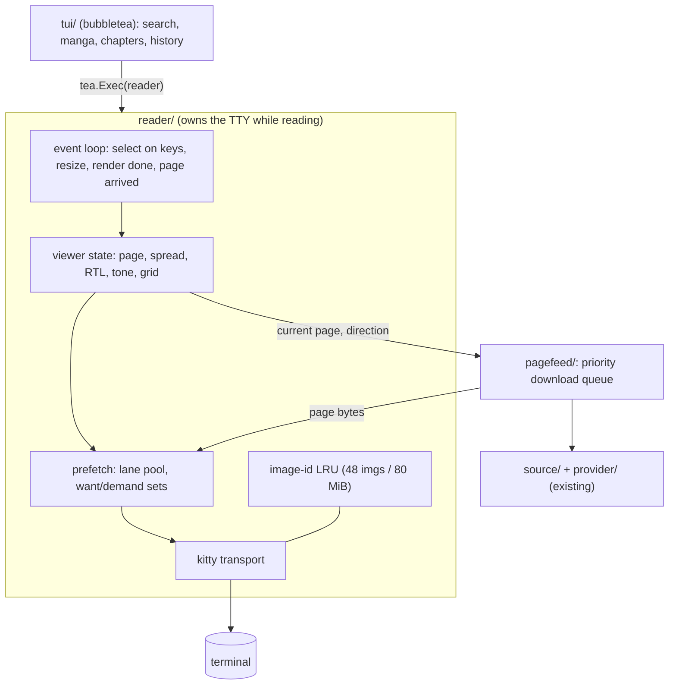

# Plan: mangaz, an all-Go TUI manga reader (mangal + pdfpane's design)

Supersedes the Go + Swift plan (commit cd3bf9a). Decision: one Go binary,
every OS. pdfpane is the reference design, not linked code.

## Decisions (locked 2026-11-21)

| Question | Decision |
|---|---|
| Name | **mangaz**: binary, module path, config dir, env prefix (`MANGAZ_*`) |
| External viewers | **None.** The built-in reader is the only way to read. A terminal without kitty graphics gets a clear error, not a fallback |
| Reading direction | **Right-to-left** by default, per-manga override |
| Tone | **Dark** by default, `d` toggles light |

## Goal

Search, pick a chapter, and read it inside the terminal, on macOS, Linux and
Windows, in any kitty-graphics terminal (kitty, ghostty, wezterm, gwae).
Page flips should feel as instant as pdfpane: about 20 ms when the page is
already cached, and no visible stall while holding `j`.

## Why all-Go works

| Layer | Implementation | OS-specific? |
|---|---|---|
| 1. Fetch | mangal sources, scrapers, downloader (exists) | No |
| 2. Decode | `image/jpeg`, `image/png`, `image/gif`, `golang.org/x/image/webp` (already vendored) | No |
| 3. Fit + tone | `golang.org/x/image/draw` scaling, per-pixel tone loops on `image.Gray` | No |
| 4. Encode | `image/png` with `BestSpeed`, `image.Gray` gives a 1-channel PNG | No |
| 5. Transport | kitty escape codes, written to stdout | No (depends on the terminal) |
| 6. Show | the terminal | n/a |

Things given up: PDF rendering (manga sources serve images) and some raw speed
compared with CoreGraphics/vImage. Phase 1 measures that cost before anything
else gets built on top of it.

Constraint found in gwae: it accepts `f=24`, `f=32` and `f=100` (PNG) but
rejects `o=z` compression. Grayscale PNG is the smallest format every target
terminal accepts, which matches pdfpane's gray-PNG fast path.

## Architecture

The key trick for the handoff: bubbletea's `tea.Exec` takes any value that
implements `ExecCommand` (`Run`, `SetStdin`, `SetStdout`, `SetStderr`). The
reader implements that interface **in-process**. Bubbletea leaves the
alternate screen and gives up the TTY, the reader takes raw control and emits
kitty codes directly, and when the reader returns the TUI repaints. There is
no subprocess and no IPC, and the image bytes never pass through bubbletea's
diffing renderer (which would mangle them).

### New packages

| Package | Ports from pdfpane | Notes |
|---|---|---|
| `reader/term` | App.swift terminal setup | raw mode via `golang.org/x/term`, alt screen, cursor hide, restore on panic/signal, cell size via `TIOCGWINSZ` pixels with `CSI 16 t` fallback (Windows, some terminals) |
| `reader/kitty` | Transport.swift, Diacritics.swift | chunked `a=T`, `a=p` re-place, `a=d,d=I` delete, U+10EEEE placeholder frames, DEC 2026 synchronized output, ids 10..249 |
| `reader/input` | Input.swift | coalescing reader: drain a batch, apply all of it, draw once. CSI swallowing, `f` goto digits |
| `reader/loop` | EventLoop.swift | one `select` over key, resize, render-done and page-arrived channels. Resize: `SIGWINCH` on unix, size polling on Windows |
| `reader/render` | Renderer.swift (layout + tone only) | aspect fit, pixel-rounded rect, black gutters, rotation, spread, scrollbar, gray detection, tone |
| `reader/prefetch` | Prefetch.swift | N worker goroutines, direction-biased warm set (+4 ahead, 1 behind), stale-job abandonment, idle trim |
| `reader/viewer` | Viewer.swift | state + cache keys (page, grid, rotation, tone, spread, generation) + LRU |
| `pagefeed` | new | streams chapter pages, reorders downloads by viewer position, reports arrivals |

Goroutines replace pdfpane's thread-confined lanes. The one rule that carries
over unchanged: **only the loop goroutine writes to stdout.**

### Placement modes

- **Placeholder mode (`U=1`)**: required inside gwae and tmux. Supported by
  kitty and ghostty.
- **Direct mode**: cursor-positioned `a=T` placement for terminals without
  placeholder support (verify wezterm).
- Pick the mode from env detection (pdfpane's `hostSupportsKittyGraphics`
  logic plus `TMUX`/`GWAE`), with an override `MANGAZ_KITTY_MODE`.
- No kitty support detected: `mangaz` refuses to open the reader and says
  which terminals work (`MANGAZ_KITTY_GRAPHICS=1` forces it on).

### Removed (no external viewers)

- `downloader/read.go` external path: `open.RunWith`, read-in-browser.
- Config keys `reader.pdf`, `reader.cbz`, `reader.zip`, `reader.plain`,
  `reader.folder`, `reader.browser`, `reader.read_in_browser` (`key/keys.go`,
  `config/default.go`). Configs that still set them get a one-time warning.
- The "open downloads folder" key in `tui/update.go`.
- Converters stay **for downloads only** (`mangaz` can still export
  pdf/cbz/zip/plain to disk). Reading never converts.
- Kept: `open.Start` for "open this manga's web page" and the Anilist OAuth
  login. Those are links, not viewers.

## Phases

### Phase 0: become mangaz (half a day) -- DONE 2026-11-21
- New repo `hongnoul/mangaz` seeded from this fork (history kept). Module
  path `github.com/hongnoul/mangaz`, `constant.Mangal` to `"mangaz"`,
  `MANGAL_*` env vars to `MANGAZ_*`, binary and completions renamed.
- Config migration: if `~/.config/mangal` exists and `~/.config/mangaz`
  doesn't, copy it once (sources, history, anilist).
- Check: `go build`, `go test ./...`, the existing TUI runs under the new name.

### Phase 1: spike + benchmark gate (1-2 days)
Standalone `mangaz view <dir|cbz>`: decode, fit, gray PNG, kitty placeholder
transport, `j`/`k`/`q`, with a basic prefetch pool.
- **Gate:** port `tests/scroll_bench.py` (it measures from keypress to the end
  of the DEC 2026 frame). Same manga chapter as a folder of images: mangaz view
  vs pdfpane on a pdfcpu PDF of it. Pass = cached flip p50 under 30 ms and
  held `j` at 15 Hz presenting at least 10 fps.
- If it fails: profile decode, scale, encode. Remedies in order: `f=32` raw
  for small panes, terminal-side scaling (send native size, let `c`/`r`
  stretch), a faster PNG encoder, more lanes. A CoreGraphics cgo backend is
  the last resort, behind a build tag.

**Result (2026-11-21): PASSED.** Fixture: Chainsaw Man ch. 1 from
Mangadex, 53 pages at 891x1300 (gray PNG, gray-palette PNG, 4 color
pages), vs pdfpane on the same chapter as a PDF. Pane 160x50 cells,
3200x1800 px. Medians of 3 runs (`tests/scroll_bench.py`):

| metric | mangaz | pdfpane |
|---|---|---|
| boot to first frame | 86 ms | 122 ms |
| flip p50 / p90 / max (30 Hz) | 15 / 30 / 54 ms | 26 / 55 / 90 ms |
| held key 30 Hz fps | 29.6 | 28.9 |
| flip p50 (60 Hz) | 24 ms | 55 ms |
| held key 60 Hz fps | 46.9 | 47.7 |
| held key 15 Hz fps (gate) | 14.8, every key framed | |

What got it there without cgo: native-density rasters (never upscale
a 1300 px scan to 3600 px, let the terminal stretch), neutral detection
so gray and gray-palette pages ship 1-channel PNG, a single-filter (Up)
PNG encoder instead of image/png's 5-way trial, and RGB instead of RGBA
for color frames (12% smaller, 35% faster deflate). Color pages remain
the slow case (~2 MB frames, first frame 85 ms on the cover); the
prefetcher hides them during reading. No remedy from the list above was
needed.

### Phase 2: in-TUI integration (1-2 days) -- DONE 2026-11-22
- `reader.Read(chapter)` implements `tea.ExecCommand` and replaces
  `downloader.Read` entirely. Delete the external-viewer code and config keys
  listed above in the same PR.
- Use the downloaded/temp pages directly, with no converter step.
- Check: MangaDex search, read, `q`, back in the chapter list with the TUI
  intact, in kitty, ghostty, wezterm and gwae.

### Phase 3: streaming + continuous reading (2-3 days)
- `pagefeed`: open the reader as soon as page 1 lands. Missing pages show a
  placeholder frame with a progress line, then swap in when they arrive.
- Downloads follow the warm set: current page, then +1..+4, then -1.
- Past the last page, prefetch and roll into the next chapter in the same
  session. Same going backward.
- Check: time to first page on a cold chapter, before vs after.

### Phase 4: manga features (ongoing)
- RTL by default (`reader.direction: rtl|ltr`, per-manga override saved with
  history). In RTL, `h`/left goes to the next page and `l`/right to the
  previous one, matching the physical book. `j`/`k` stay next/prev in both modes.
  Spread view puts the cover alone, then pairs with the earlier page on the
  right.
- Tones: `dark` (default), `light`, `dim`. `dark` is a plain inversion with
  ink landing at soft gray (pdfpane's 224/255 cap), so it doesn't glare.
  Color pages get pdfpane's hue-preserving flip. Skip photo detection: manga
  pages are a single image, so there are no embedded photos to exempt.
  Config: `reader.tone`, `d` cycles at runtime.
- Rotation moves off `h`/`l` (taken by RTL paging) to `r`/`R`.
- Page-level history: `{manga, chapter, page}` stored on every flip, plus a
  "continue" entry in the history view.
- Webtoon mode: slice tall strips into pane-height tiles and scroll by tile.
  This is a new render path, so it comes last.

### Phase 5: cross-platform hardening + ship
- CI matrix: macOS, Linux and Windows builds. A PTY protocol test (port
  `tests/protocol_test.py` to Go using `creack/pty`) on macOS and Linux.
- Windows: verify in wezterm. Windows Terminal gets the "unsupported
  terminal" error (sixel is out of scope until requested).
- Separate PR: bump Go 1.18 to current, bubbletea 0.23 to current. Prune dead
  scrapers.
- README, `go install`, goreleaser for binaries.

## Risks

| Risk | Mitigation |
|---|---|
| Go decode/encode too slow on big pages | Phase 1 gate before building on it. Terminal-side scaling. Prefetch hides most of the cost |
| Terminal differences in kitty support | Two placement modes, per-terminal e2e checks, env override |
| Raw mode left on after a crash | Restore on `defer`, signal handler and panic recovery. Bubbletea re-inits on return |
| Upstream mangal unmaintained, old deps | Dependency bumps isolated in their own PR |
| Some scrapers return unusual formats (AVIF) | Skip with a visible notice. Add a decoder only if a used source needs it |
| No fallback means non-kitty users can't read at all | Accepted on purpose. The error names working terminals. Sixel can be added later as a second transport |
