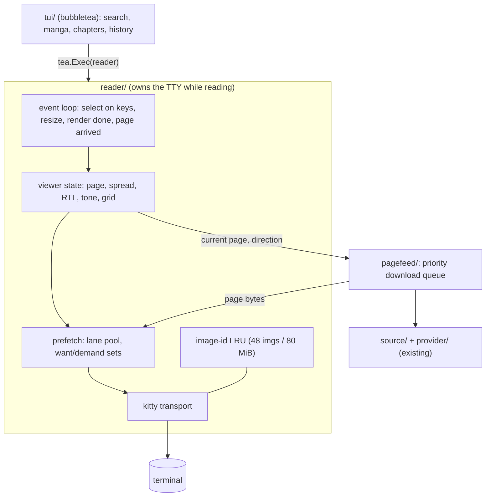

# Plan: all-Go TUI manga reader (mangal + pdfpane's design)

Supersedes the Go + Swift plan (commit cd3bf9a). Decision: one Go binary,
every OS. pdfpane is the reference design, not linked code.

## Goal

Search, pick a chapter, and read it inside the terminal, on macOS, Linux and
Windows, in any kitty-graphics terminal (kitty, ghostty, wezterm, gwae).
Page flips should feel as instant as pdfpane: about 20 ms when the page is
already cached, and no visible stall while holding `j`.

## Why all-Go works

| Layer | Implementation | OS-specific? |
|---|---|---|
| 1. Fetch | mangal sources, scrapers, downloader (exists) | No |
| 2. Decode | `image/jpeg`, `image/png`, `image/gif`, `golang.org/x/image/webp` (already vendored) | No |
| 3. Fit + tone | `golang.org/x/image/draw` scaling, per-pixel tone loops on `image.Gray` | No |
| 4. Encode | `image/png` with `BestSpeed`, `image.Gray` gives a 1-channel PNG | No |
| 5. Transport | kitty escape codes, written to stdout | No (depends on the terminal) |
| 6. Show | the terminal | n/a |

Things given up: PDF rendering (manga sources serve images) and some raw speed
compared with CoreGraphics/vImage. Phase 1 measures that cost before anything
else gets built on top of it.

Constraint found in gwae: it accepts `f=24`, `f=32` and `f=100` (PNG) but
rejects `o=z` compression. Grayscale PNG is the smallest format every target
terminal accepts, which matches pdfpane's gray-PNG fast path.

## Architecture

The key trick for the handoff: bubbletea's `tea.Exec` takes any value that
implements `ExecCommand` (`Run`, `SetStdin`, `SetStdout`, `SetStderr`). The
reader implements that interface **in-process**. Bubbletea leaves the
alternate screen and gives up the TTY, the reader takes raw control and emits
kitty codes directly, and when the reader returns the TUI repaints. There is
no subprocess and no IPC, and the image bytes never pass through bubbletea's
diffing renderer (which would mangle them).

### New packages

| Package | Ports from pdfpane | Notes |
|---|---|---|
| `reader/term` | App.swift terminal setup | raw mode via `golang.org/x/term`, alt screen, cursor hide, restore on panic/signal, cell size via `TIOCGWINSZ` pixels with `CSI 16 t` fallback (Windows, some terminals) |
| `reader/kitty` | Transport.swift, Diacritics.swift | chunked `a=T`, `a=p` re-place, `a=d,d=I` delete, U+10EEEE placeholder frames, DEC 2026 synchronized output, ids 10..249 |
| `reader/input` | Input.swift | coalescing reader: drain a batch, apply all of it, draw once. CSI swallowing, `f` goto digits |
| `reader/loop` | EventLoop.swift | one `select` over key, resize, render-done and page-arrived channels. Resize: `SIGWINCH` on unix, size polling on Windows |
| `reader/render` | Renderer.swift (layout + tone only) | aspect fit, pixel-rounded rect, black gutters, rotation, spread, scrollbar, gray detection, tone |
| `reader/prefetch` | Prefetch.swift | N worker goroutines, direction-biased warm set (+4 ahead, 1 behind), stale-job abandonment, idle trim |
| `reader/viewer` | Viewer.swift | state + cache keys (page, grid, rotation, tone, spread, generation) + LRU |
| `pagefeed` | new | streams chapter pages, reorders downloads by viewer position, reports arrivals |

Goroutines replace pdfpane's thread-confined lanes. The one rule that carries
over unchanged: **only the loop goroutine writes to stdout.**

### Placement modes

- **Placeholder mode (`U=1`)**: required inside gwae and tmux. Supported by
  kitty and ghostty.
- **Direct mode**: cursor-positioned `a=T` placement for terminals without
  placeholder support (verify wezterm).
- Pick the mode from env detection (pdfpane's `hostSupportsKittyGraphics`
  logic plus `TMUX`/`GWAE`), with an override `MANGAL_KITTY_MODE`.

## Phases

### Phase 1: spike + benchmark gate (1-2 days)
Standalone `cmd/mangaview <dir|cbz>`: decode, fit, gray PNG, kitty placeholder
transport, `j`/`k`/`q`, with a basic prefetch pool.
- **Gate:** port `tests/scroll_bench.py` (it measures from keypress to the end
  of the DEC 2026 frame). Same manga chapter as a folder of images: mangaview
  vs pdfpane on a pdfcpu PDF of it. Pass = cached flip p50 under 30 ms and
  held `j` at 15 Hz presenting at least 10 fps.
- If it fails: profile decode, scale, encode. Remedies in order: `f=32` raw
  for small panes, terminal-side scaling (send native size, let `c`/`r`
  stretch), a faster PNG encoder, more lanes. A CoreGraphics cgo backend is
  the last resort, behind a build tag.

### Phase 2: in-TUI integration (1-2 days)
- `reader.Read(chapter)` implements `tea.ExecCommand`. Add `reader.use: tui`
  config (default when a kitty terminal is detected, else today's external
  reader).
- Use mangal's downloaded/temp pages directly, with no converter step.
- Check: MangaDex search, read, `q`, back in the chapter list with the TUI
  intact, in kitty, ghostty, wezterm and gwae.

### Phase 3: streaming + continuous reading (2-3 days)
- `pagefeed`: open the reader as soon as page 1 lands. Missing pages show a
  placeholder frame with a progress line, then swap in when they arrive.
- Downloads follow the warm set: current page, then +1..+4, then -1.
- Past the last page, prefetch and roll into the next chapter in the same
  session. Same going backward.
- Check: time to first page on a cold chapter, before vs after.

### Phase 4: manga features (ongoing)
- RTL by default with per-manga override. Spread view with the cover alone,
  pairs ordered RTL.
- Tones: `light` (default for manga), `dim` (85% brightness, no inversion),
  `invert`. Skip pdfpane's smart tone: photo detection doesn't apply to manga.
- Page-level history: `{manga, chapter, page}` stored on every flip, plus a
  "continue" entry in the history view.
- Webtoon mode: slice tall strips into pane-height tiles and scroll by tile.
  This is a new render path, so it comes last.

### Phase 5: cross-platform hardening + ship
- CI matrix: macOS, Linux and Windows builds. A PTY protocol test (port
  `tests/protocol_test.py` to Go using `creack/pty`) on macOS and Linux.
- Windows: verify in wezterm. Detect Windows Terminal and fall back with a clear
  message (sixel is out of scope until requested).
- Separate PR: bump Go 1.18 to current, bubbletea 0.23 to current. Prune dead
  scrapers.
- Rename, README, `go install`, goreleaser for binaries.

## Risks

| Risk | Mitigation |
|---|---|
| Go decode/encode too slow on big pages | Phase 1 gate before building on it. Terminal-side scaling. Prefetch hides most of the cost |
| Terminal differences in kitty support | Two placement modes, per-terminal e2e checks, env override |
| Raw mode left on after a crash | Restore on `defer`, signal handler and panic recovery. Bubbletea re-inits on return |
| Upstream mangal unmaintained, old deps | Dependency bumps isolated in their own PR |
| Some scrapers return unusual formats (AVIF) | Skip with a visible notice. Add a decoder only if a used source needs it |

## Open questions
1. App name.
2. Keep mangal's external-reader path for non-kitty terminals, or drop it?
3. Defaults: RTL plus light tone?
