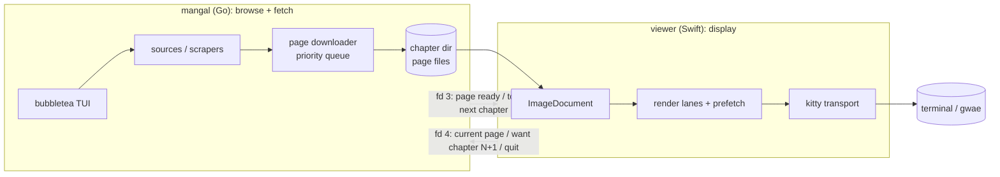

# Plan: mangal + pdfpane → one TUI manga reader

## What each side brings

| | mangal (Go, ~12k LOC) | pdfpane (Swift, ~2.5k LOC) |
|---|---|---|
| Strength | Sources (Lua scrapers, MangaDex, Manganato...), search/chapter TUI (bubbletea), downloads, history, Anilist | Fast in-terminal page display: kitty graphics + gwae, render lanes, direction-biased prefetch, LRU image ids, kqueue input, spread view, dark tones |
| Gap | No viewer. `downloader.Read` converts to PDF/CBZ and shells out (`open -a` on macOS, a GUI app) | PDF-only input (`CGPDFDocument`), one file per process, no notion of chapters |

Builds today: `go build` succeeds on Go 1.27 with the vendored deps.

## Key observation

Manga pages are images. Today's path is image → pdfcpu PDF → CoreGraphics
raster → PNG. The PDF hop is pure waste. pdfpane's real value for manga is
everything *around* the rasterizer (transport, cache, prefetch, input), plus
its scan fast path and gray PNG (most manga is grayscale, so ~4x fewer bytes).

## Architecture decision: two processes, one app

Options considered:

1. **Go frontend + Swift viewer subprocess (chosen).** Each half stays in the
   language it's good at. Handoff via `tea.ExecProcess`, which releases the
   TTY cleanly. Small JSON-lines control channel on extra fds.
2. Port pdfpane's display to Go. Loses ImageIO/vImage/CoreGraphics speed and
   two months of measured latency work. No.
3. Port mangal to Swift. Rewrites gopher-lua scrapers, MangaDex client, TUI.
   Weeks of work for no user-visible gain. No.
4. Link Go as a c-archive into Swift. Cgo + Swift 6 concurrency + one TTY
   owner is a debugging tax. Revisit only if two processes prove limiting.

## Repo strategy

- New repo (name TBD) seeded from this mangal fork so Go history survives.
- In pdfpane, split `Package.swift` into a library target `PaneKit`
  (Transport, Diacritics, EventLoop, Input, Viewer cache, Prefetch) plus the
  `pdfpane` executable. The new app adds a `mangaview` executable that
  depends on PaneKit (SwiftPM git or path dependency). Latency fixes then
  flow to both viewers instead of forking.
- Layout: `go/` (mangal), `viewer/` (Swift package), one `Makefile` that
  builds both and runs `codesign -f -s -` on the installed viewer.
- Non-macOS: keep mangal's existing external-reader path as the fallback.

## Phases

### Phase 0: wire-up MVP (half a day)
- Add reader mode `tui` in `downloader/openRead`: run the viewer with
  `tea.ExecProcess` instead of `open -a` (which spawns a GUI app and returns).
- Use format `pdf`, reader `pdfpane`. Works end to end with zero viewer
  changes, proves the TTY handoff inside kitty/ghostty/gwae.
- Check: read a MangaDex chapter, quit with `q`, land back in the chapter list.

### Phase 1: image document backend (1-2 days)
- In the viewer, introduce `protocol PageSource { pageCount; draw(page, into ctx, rect) }`.
  `PDFSource` wraps today's Renderer; `ImageDirSource` / `CBZSource` decode with
  `CGImageSource` (jpg/png/webp/gif all native). Renderer's fit, tone, gray PNG,
  scrollbar, rotation stay unchanged.
- mangal reads with format `plain` (or `cbz`, which is already `zip.Store`),
  skipping pdfcpu entirely.
- Check: extend pdfpane's PTY tests with an image-dir fixture, rerun
  `scroll_bench.py`, compare flip latency against the PDF path.

### Phase 2: streaming open (2-3 days)
- Open the viewer as soon as page 1 lands, not after the whole chapter.
- Go writes pages into the chapter dir and announces them on fd 3
  (`{"page":3,"path":"...","total":24}`). Viewer adds an EVFILT_READ on fd 3
  to its existing kqueue, shows a lightweight "loading" frame for missing pages.
- Viewer reports the current page on fd 4. Go reorders downloads to match the
  viewer's direction-biased warm set (current, +1..+4, -1).
- Check: time-to-first-page on a cold chapter, before vs after.

### Phase 3: manga reading features (ongoing)
- Right-to-left by default (configurable per source/manga), so j/l and spread
  order match manga reading. Spread view with a cover offset (page 1 alone).
- Tone: smart dark inverts B&W manga line art, which many readers dislike.
  Add a `manga` tone (dim only, or off) and make light the manga default.
- Continuous chapters: `j` past the last page sends `want-chapter next`; Go
  fetches and streams it into the same viewer session, no exit/re-enter.
- Page-level history: persist `{chapter, page}` from fd 4, "continue reading"
  entry in the history screen resumes at the exact page.
- Later: webtoon mode (vertical strips). pdfpane deliberately has no in-page
  scrolling, so this is a real new render mode: tile tall images into
  pane-height slices, prefetch by slice.

### Phase 4: polish and ship
- New name, README, single `make install`, Homebrew formula installing both
  binaries. Prune sources that no longer work, check MangaDex API drift.
- Config: unify `PDFPANE_*` env knobs and mangal's viper config so the
  viewer reads tone/direction/spread from mangal's config via argv.

## Risks
- mangal upstream is unmaintained; scrapers and deps (bubbletea 0.23) are old.
  Keep the bubbletea upgrade separate from feature work.
- Two processes share one TTY: the Go side must not write anything while the
  viewer runs (bubbletea's ExecProcess handles this, but logging must go to file).
- Signing: the installed viewer must be re-signed after copy, or it is
  SIGKILLed on Apple silicon.
- WebP/AVIF from some sources: CGImageSource handles WebP; AVIF needs macOS 13+
  (already the minimum).

## Open questions for Justin
1. Name for the new app.
2. Shared `PaneKit` library vs. copy-and-diverge the pdfpane code.
3. Default reading direction and tone for manga.
